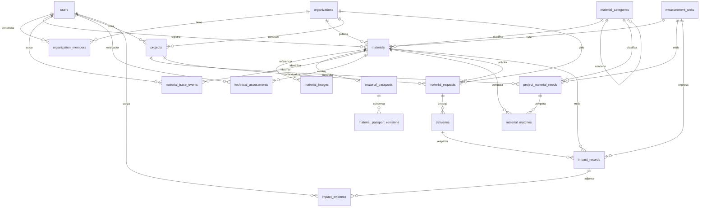

# REOBRA — modelo de datos (Fase 2)

Esta fase crea el esquema relacional de REOBRA en MySQL 8. No activa todavía registro, inventario, carga de archivos, códigos QR, compatibilidad automática ni cálculo de impacto.

La interfaz de la Fase 1 permanece igual.

## Decisiones

- Identificadores internos `BIGINT UNSIGNED`. El código público del pasaporte es otro campo, opaco, con forma `rob_` y 20 caracteres `a-z0-9`. No se deriva del id ni incluye correo, teléfono o identificador tributario.
- `password_hash` solo admite valores de 20 caracteres o más. La aplicación futura debe guardar un hash. El esquema rechaza una clave corta en texto plano, pero no sustituye el cifrado.
- La unidad de un material sale del catálogo `measurement_units`. Solicitudes y entregas no tienen unidad propia: usan la del material. Una necesidad de proyecto sí elige unidad, porque existe antes de emparejarse con un material.
- `availability_status` dice si la organización ofrece el material. `technical_validation_status` dice qué se sabe de su aptitud. Publicar un material no lo vuelve apto. `pending` no significa seguro ni reutilizable.
- Una fila de `technical_assessments` es un registro de evaluación. No es una certificación profesional ni legal.
- `material_matches` guarda una coincidencia preliminar. Un estado `compatible` no aprueba el uso técnico. No hay puntuaciones generadas por esta fase. Una coincidencia `pending` o `not_evaluated` no puede llevar puntuación.
- La cantidad publicada vive en `materials.quantity`. Lo entregado y lo comprometido se leen en la vista `material_quantity_summary`. Solo una solicitud `accepted` o `partially_fulfilled` compromete saldo. Un borrador o una solicitud enviada todavía no reserva.
- La vista puede mostrar disponible negativo si dos solicitudes aceptadas superan la cantidad publicada. Esta fase no bloquea ese caso: todavía no hay un inventario transaccional con bloqueo de fila. La fase que acepte solicitudes deberá hacerlo dentro de una transacción.
- La suma de entregas y la coherencia entre un impacto y el material de su entrega están escritas en `backend/database/optional/integrity-triggers.sql`. No se aplican solas: esta instalación de MySQL tiene el registro binario activo y la cuenta de la aplicación no puede crear disparadores.
- El impacto exige método y estado `estimated`, `verified` o `rejected`. No hay filas de impacto precargadas. Recuperar un material no crea por sí solo un registro de emisiones evitadas.
- El mismo impacto no puede repetirse para el mismo material, la misma entrega y el mismo método. El alcance sin entrega usa la clave `material`.
- La regla de que un impacto pertenezca al material de su entrega está en el script opcional. Hoy la clave foránea solo exige que la entrega exista.
- Las imágenes y las evidencias guardan una clave o ruta. El esquema rechaza un `data:` embebido. No hay columnas binarias.
- Las claves foráneas usan `ON DELETE RESTRICT`. Borrar una organización o un material con historia exige una decisión explícita posterior.
- No se usa un ORM. Las migraciones son SQL ejecutado con `mysql2`.
- MySQL confirma cada enunciado DDL por separado. Una migración que falle a la mitad no queda registrada y no se revierte sola.

## Diagrama



## Tablas

| Tabla | Papel |
| --- | --- |
| `schema_migrations` | Control interno de migraciones. La crea el ejecutor, no un archivo SQL. |
| `users` | Persona con correo único y hash de contraseña. |
| `organizations` | Empresa, entidad pública, institución educativa, organización sin ánimo de lucro u otro. |
| `organization_members` | Pertenencia de una persona a una organización, con un rol. Una pareja usuario-organización no se repite. |
| `measurement_units` | Catálogo fijo: kg, t, m, m2, m3, L y unit. |
| `material_categories` | Categorías y subcategorías. Una categoría no puede ser su propio padre. |
| `materials` | Material publicado por una organización. Cantidad mayor que cero. |
| `material_images` | Orden y clave de almacenamiento de cada imagen. |
| `material_passports` | Identidad estable del pasaporte, una por material, y su versión vigente. |
| `material_passport_revisions` | Copia de la versión anterior cuando cambia el contenido o el número de versión. |
| `material_trace_events` | Hechos append-only. No se actualizan. |
| `technical_assessments` | Evaluaciones independientes del estado comercial. |
| `projects` | Proyecto de una organización. |
| `project_material_needs` | Cada necesidad de material de un proyecto. |
| `material_matches` | Una coincidencia vigente por material y necesidad. |
| `material_requests` | Solicitud, total o parcial, de una organización sobre un material. |
| `deliveries` | Una o varias entregas de una solicitud. |
| `impact_records` | Indicador con valor, unidad, método y verificación. |
| `impact_evidence` | Referencia de evidencia de un indicador. |
| `material_quantity_summary` | Vista de cantidad publicada, entregada, comprometida y disponible. |

## Estados

- Cuenta: `active`, `suspended`, `deactivated`.
- Tipo de organización: `company`, `public_entity`, `educational`, `nonprofit`, `other`.
- Verificación de organización: `unverified`, `pending`, `verified`, `rejected`.
- Rol de membresía: `owner`, `administrator`, `editor`, `technical_reviewer`, `viewer`.
- Estado de membresía: `invited`, `active`, `suspended`.
- Condición del material: `not_declared`, `good`, `fair`, `deteriorated`, `mixed`.
- Origen: `construction`, `industrial`, `demolition`, `other`.
- Disponibilidad: `draft`, `published`, `paused`, `withdrawn`.
- Validación técnica: `pending`, `in_review`, `insufficient_information`, `not_suitable`, `conditionally_suitable`, `suitable_for_stated_use`.
- Proyecto: `draft`, `active`, `paused`, `completed`, `cancelled`.
- Necesidad: `open`, `partially_covered`, `covered`, `cancelled`.
- Coincidencia: `not_evaluated`, `pending`, `incompatible`, `partially_compatible`, `compatible`.
- Método de coincidencia: `manual`, `rule_based`, `model_assisted`.
- Solicitud: `draft`, `submitted`, `accepted`, `partially_fulfilled`, `fulfilled`, `rejected`, `cancelled`.
- Entrega: `scheduled`, `in_transit`, `delivered`, `cancelled`.
- Resultado de evaluación: `insufficient_information`, `not_suitable`, `conditionally_suitable`, `suitable_for_stated_use`.
- Impacto: `mass_recovered`, `volume_recovered`, `emissions_avoided`, `other`.
- Verificación del impacto: `estimated`, `verified`, `rejected`.

## Cantidades

`material_quantity_summary` calcula:

- `published_quantity`: `materials.quantity`.
- `delivered_quantity`: suma de `deliveries.delivered_quantity` con estado `delivered`.
- `committed_quantity`: saldo no entregado de solicitudes `accepted` o `partially_fulfilled`.
- `available_quantity`: publicada menos entregada menos comprometida.

La aceptación futura de una solicitud debe bloquear la fila del material, volver a leer este cálculo y rechazar la operación si la cantidad pedida supera lo disponible. Dos aceptaciones simultáneas todavía pueden sobrecomprometer el material.

## Migraciones

Archivos en `backend/database/migrations`, del `0001` al `0008`. La reversión correspondiente está en `backend/database/rollbacks`.

Desde la raíz, en PowerShell:

```powershell
npm run db:migrate
npm run db:status
npm run db:verify
```

Revertir solo la última migración aplicada, cuando sus tablas no tengan filas:

```powershell
npm run db:rollback -- --confirm
```

Si esas tablas tienen filas, el comando se detiene. Borrarlas exige una autorización explícita y elimina datos:

```powershell
npm run db:rollback -- --discard-data --confirm
```

Ejecute la reversión varias veces solo si realmente quiere deshacer el esquema en orden inverso. `0002` inserta el catálogo de unidades; revertirlo con `--discard-data` borra ese catálogo.

El ejecutor:

- rechaza `NODE_ENV=production`;
- solo actúa sobre la base `reobra`, o sobre `reobra_test` cuando `NODE_ENV=test`;
- toma un bloqueo `GET_LOCK` para no correr dos veces en paralelo;
- guarda versión, nombre y checksum en `schema_migrations`;
- no vuelve a ejecutar una versión registrada;
- se detiene si un archivo ya aplicado cambió su checksum;
- no imprime la contraseña de la base.

Si un archivo falla a mitad de camino, MySQL ya habrá confirmado los `CREATE` anteriores. No repita el comando a ciegas: revise qué objetos quedaron, corríjalos con la reversión documentada o de forma manual, y solo entonces vuelva a migrar. No hay transacción que deshaga todo un archivo DDL.

## Verificación

`npm run db:verify` comprueba tablas, motor InnoDB, `utf8mb4`, claves foráneas, índices, restricciones `CHECK`, unidades de referencia y que cada archivo coincida con `schema_migrations`.

`npm test` además inserta datos dentro de transacciones que se revierten. Esas pruebas cubren cantidad negativa o cero, correo duplicado, organización inexistente, la cadena material-proyecto-solicitud-entrega-impacto y que una revisión de pasaporte no se duplique.

## Limitaciones

- La Fase 4 usa las tablas de identidad ya creadas y añade `0009_sessions_and_invitations.sql`: sesiones, intentos de acceso e invitaciones. El rol de `organization_members` se comprueba en la API. Crear una organización no cambia `verification_status`: sigue en `unverified` hasta un procedimiento que esta fase no incluye.
- Una categoría no puede ser su propio padre en el script opcional de disparadores. MySQL no acepta esa regla como `CHECK` porque `id` es autonumérico. Un ciclo más largo entre categorías sigue siendo posible. El historial del pasaporte tampoco se copia solo: la tabla `material_passport_revisions` está lista y el disparador opcional la llena al actualizar el pasaporte.
- La Fase 9 comprueba que la necesidad usada al crear una solicitud pertenezca a una organización distinta de la propietaria del material y que el usuario pueda escribir en ella.
- No se exige que la unidad de una necesidad coincida con la del material emparejado.
- Sin el script opcional, actualizar un pasaporte no guarda la versión anterior y varias entregas pueden sumar más que la solicitud.
- Aunque se instalen los disparadores, dos entregas simultáneas todavía pueden superar la cantidad pedida. Hace falta un bloqueo en la transacción de la fase que opere las entregas.
- No hay reserva automática al crear una solicitud.
- La Fase 5 añade `0010_material_category_catalog.sql`, un catálogo de categorías. No altera tablas. Las imágenes del inventario se guardan en disco (`backend/storage`), no en MySQL.
- La Fase 6 añade `0011_passport_visibility_and_evidence.sql`: visibilidad del pasaporte, clave de operación del historial, tipos de evento de evidencia y la tabla `material_documents`. Los pasaportes de materiales ya existentes se crean en esa migración. `0012_trace_event_organization_backfill.sql` y `0013_trace_event_organization_repair.sql` vuelven a asociar la organización cuando esos eventos históricos quedaron sin ella. El historial es de solo adición en la API; un administrador de la base puede modificar filas directamente. No hay cadena de bloques.
- La Fase 7 añade `0014_project_operations.sql`: identificador público, visibilidad, dirección privada, responsable, prioridades y el historial `project_events`. No reserva materiales ni crea entregas.
- La Fase 8 añade `0015_matching_engine.sql`: factores, cobertura y versión del algoritmo sobre `material_matches`, más el registro `matching_runs`. No reserva ni entrega materiales.
- La Fase 9 añade `0016_material_operations.sql`: propuestas, confirmaciones, logística, eventos, avisos internos, incidencias y archivos. Reutiliza `material_requests` y `deliveries`. La vista `material_quantity_summary` no cambia de fórmula. Reservar pasa la solicitud a `accepted`. Despachar inserta una entrega `delivered`. La recepción llena columnas nuevas y no vuelve a descontar.
- La Fase 10 añade `0017_impact_engine.sql`: el gramo como unidad de masa y las tablas `impact_methodologies`, `impact_factors`, `impact_mass_parameters`, `impact_calculations`, `impact_calculation_sources`, `impact_reports`, `impact_report_items` e `impact_audit_events`. No reemplaza `impact_records` ni `impact_evidence`. No inserta factores numéricos. El total recibido sale de `deliveries.received_quantity` cuando `received_at` no es nulo. Un informe copia las cifras al emitirse. Corregir una recepción cambia el indicador vivo y deja el informe anterior intacto.
- La Fase 11 añade `0018_ai_assistant.sql`: conversaciones, mensajes, metadatos de herramientas, propuestas, consumo, valoraciones y auditoría. No guarda claves ni la carga completa de una herramienta. Confirmar una propuesta no reserva inventario ni certifica un material.

## Siguiente fase

La medición usa recepciones confirmadas, conversiones exactas y factores que la propia organización documente. Siguen fuera de esta base la certificación ambiental, la firma electrónica certificada, los transportistas externos y los pagos.
